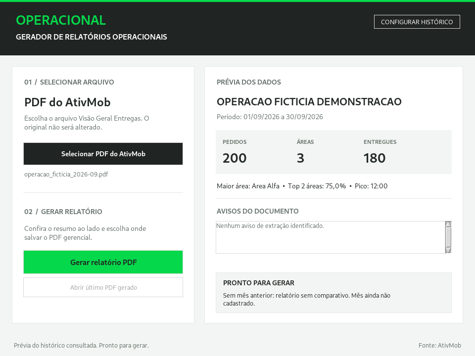

# Gerador de Relatórios Operacionais

*Projeto empresarial · Versão de portfólio independente*

Aplicação desktop para Windows desenvolvida em Python para automatizar a transformação de PDFs operacionais do AtivMob (Visão Geral Entregas) em relatórios gerenciais padronizados, com indicadores, gráficos e comparativos mensais.

## Contexto empresarial

Desenvolvido durante minha atuação como Analista de Dados no setor de logística, para atender uma demanda real de operação. A versão original foi entregue para uso interno; esta adaptação de portfólio preserva o fluxo técnico, sem dados ou identidade visual da empresa.

Este repositório contém exclusivamente a versão independente de portfólio, com histórico Git próprio. A implementação corporativa original é mantida separadamente e não é necessária para executar esta versão.

**Status da solução original:** projeto entregue para uso interno e em manutenção. A distribuição em executável foi homologada em dois computadores Windows. Alterações no código-fonte exigem nova validação antes da distribuição.

## Demonstração



Os exemplos abaixo utilizam exclusivamente dados operacionais fictícios. Os relatórios de saída foram gerados pela própria aplicação.

| Competência | PDF de entrada | Relatório gerado |
| --- | --- | --- |
| Setembro/2026 | [PDF fictício](demonstracao/entrada/operacao_ficticia_2026-09.pdf) | [Relatório de setembro](demonstracao/saida/Relatorio_Demonstrativo_2026-09.pdf) |
| Outubro/2026 | [PDF fictício](demonstracao/entrada/operacao_ficticia_2026-10.pdf) | [Relatório de outubro com comparativo](demonstracao/saida/Relatorio_Demonstrativo_2026-10.pdf) |

Outra captura: [tela inicial](demonstracao/imagens/01-tela-inicial.png).

No exemplo, setembro contém 200 pedidos e outubro contém 250. O histórico permite gerar automaticamente a terceira página do relatório de outubro, com a variação de volume entre as duas competências. Esses números são demonstrativos, não resultados reais da empresa.

## Problema e solução

O processo de análise parte de documentos PDF com dados operacionais. A aplicação centraliza a leitura dos documentos, a consolidação dos indicadores e a geração de relatórios em um fluxo único, reduzindo a necessidade de tratamento manual repetitivo.

O PDF original é preservado. Os dados extraídos são validados antes da geração, e os registros mensais são armazenados para permitir comparações entre períodos consecutivos da mesma operação.

## Funcionalidades

- Importação de um PDF por vez, com validação do formato, prévia dos indicadores e avisos de extração.
- Indicadores de pedidos, entregas, distribuição por área, concentração e movimentação por horário.
- Extração dinâmica de categorias de finalização, com quantidade e percentual; valores incompletos não são estimados.
- Geração de relatórios PDF com visão geral, gráficos, finalizações e comparativo mensal quando disponível.
- Histórico compartilhado em JSON, identificado por operação e competência.
- Prevenção de duplicidade e bloqueio de substituição silenciosa de registros divergentes.
- Backups verificáveis dos registros de histórico e ferramentas de recuperação supervisionada.
- Interface gráfica em Tkinter e possibilidade de distribuição por executável Windows.

## Tecnologias

| Tecnologia | Aplicação |
| --- | --- |
| Python 3.13 | Lógica, validações e integração dos módulos |
| PyMuPDF | Leitura e extração de dados dos PDFs |
| ReportLab | Geração dos relatórios |
| Pillow | Tratamento de recursos gráficos |
| Tkinter | Interface desktop |
| JSON | Persistência do histórico mensal |
| unittest / pytest | Testes automatizados |
| PyInstaller | Empacotamento para Windows |

## Arquitetura

```text
PDF de entrada
    → Extração e validação
    → Indicadores e prévia
    → Consulta ao histórico e comparativo
    → Geração do PDF
    → Registro mensal e backup
```

O código separa as responsabilidades de extração, cálculo, geração de documentos, persistência e interface:

```text
src/
├── ler_pdf.py             # Extração e validação dos dados
├── indicadores.py         # Indicadores operacionais
├── comparativo.py         # Comparação entre competências
├── historico.py           # Persistência e controle de registros
├── backup_historico.py    # Cópias verificáveis do histórico
├── recuperar_historico.py # Recuperação supervisionada
├── fluxo_operacional.py   # Orquestração do processo
├── gerar_relatorio.py     # Geração de PDF
└── interface.py          # Interface gráfica
```

A pasta `tests/` contém as suítes de testes automatizados; `assets/` contém os recursos visuais e `demonstracao/` reúne os exemplos fictícios de entrada, saída e capturas da interface.

## Como executar

Ambiente de referência: Windows 10 e Python 3.13. Na raiz do projeto, usando PowerShell:

```powershell
py -3.13 -m venv .venv
.\.venv\Scripts\python.exe -m pip install -r requirements.txt
```

Para executar uma demonstração isolada, sem reutilizar a configuração corporativa:

```powershell
.\.venv\Scripts\python.exe -c "import os, tempfile; os.environ['LOCALAPPDATA'] = tempfile.mkdtemp(prefix='relatorios-demo-'); from src.interface import main; main()"
```

1. Crie duas pastas locais vazias fora do repositório, uma para o histórico e outra para os backups da demonstração.
2. Na interface, abra **CONFIGURAR HISTÓRICO** e selecione essas duas pastas existentes.
3. Importe o PDF fictício de setembro, confira a prévia e gere o relatório em uma pasta de saída de sua escolha.
4. Na mesma sessão, importe outubro e gere o segundo relatório. O comparativo utiliza o registro de setembro.

O comando isolado cria uma configuração temporária por execução. Não utilize pastas ou registros da operação real nos testes demonstrativos.

## Testes automatizados

```powershell
.\.venv\Scripts\python.exe -m unittest discover -s tests -v
```

Também é possível executar com pytest:

```powershell
.\.venv\Scripts\python.exe -m pip install pytest
.\.venv\Scripts\python.exe -m pytest -q
```

Na validação da versão de portfólio em 25/11/2026, foram aprovados **107 testes automatizados no Windows**, com Python 3.13, sem falhas. A geração dos relatórios fictícios de setembro e outubro, incluindo histórico, backup e comparativo mensal, também foi validada na interface. As suítes abrangem extração, indicadores, categorias dinâmicas, relatórios, histórico, backup, recuperação, comparativo e integração do fluxo.

## Confiabilidade e limitações

- O formato de entrada esperado é o PDF Visão Geral Entregas do AtivMob; alterações estruturais na origem podem exigir manutenção do extrator.
- A métrica de entregas exige a legenda completa `Entregue`. Categorias incompletas não são inferidas; os percentuais de finalização são reproduzidos da fonte.
- O histórico exige períodos mensais completos e compara apenas competências consecutivas da mesma operação.
- Registros idênticos podem ser reutilizados sem duplicação; divergências bloqueiam a substituição do histórico.
- A indisponibilidade do histórico ou backup pode impedir a geração. Se a falha ocorrer depois de salvar o PDF, a aplicação sinaliza conclusão parcial.
- O backup protege os arquivos JSON do histórico, não os PDFs. A proteção contra perda do servidor depende de uma política de cópias independentes.
- Os comparativos descrevem variações de volume, sem inferir qualidade, SLA ou desempenho. Os tempos operacionais não são apresentados no relatório gerencial desta versão.
- Não há envio automático por e-mail, painel online ou edição manual de histórico pela interface.

## Identidade visual

A aplicação e os relatórios utilizam identidade neutra por padrão. Opcionalmente, coloque um logotipo autorizado em `assets/logo.png`; o cabeçalho do PDF o exibirá proporcionalmente. O extrator continua compatível com o formato de entrada AtivMob descrito acima.

## Empacotamento Windows

Com o ambiente virtual ativado:

```powershell
python -m pip install pyinstaller
$assets = (Resolve-Path -LiteralPath ".\assets").Path
python -m PyInstaller --noconfirm --clean --onefile --windowed --paths "." --add-data "$assets;assets" --collect-data pymupdf --specpath "build" --name "Gerador de Relatorios" "src/interface.py"
```

O executável é gerado em `dist/`. Deve ser validado antes de qualquer distribuição; alterações no código-fonte não atualizam automaticamente o executável existente.

## Privacidade

Os materiais demonstrativos utilizam dados fictícios. PDFs corporativos, registros reais de histórico, configurações locais, credenciais, ambientes virtuais e artefatos de compilação não devem ser publicados.
